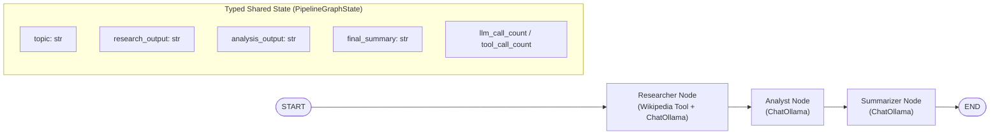
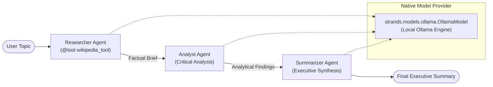

# Multi-Agent Wikipedia Research Pipeline: LangGraph vs. Strands Agents

A dual-framework portfolio project implementing an identical three-agent sequential research pipeline in **LangGraph** and **Strands Agents**, powered entirely by a **local LLM** running through Docker via [Ollama](https://ollama.com/).

No paid or cloud API keys required.

---

## Table of Contents

- [Overview & Motivation](#overview--motivation)
- [The Multi-Agent Pipeline](#the-multi-agent-pipeline)
- [Architecture Diagrams](#architecture-diagrams)
  - [1. LangGraph Architecture](#1-langgraph-architecture)
  - [2. Strands Agents Architecture](#2-strands-agents-architecture)
- [Project Structure](#project-structure)
- [Prerequisites & Hardware Guidance](#prerequisites--hardware-guidance)
- [Local LLM Model Selection](#local-llm-model-selection)
- [Quick Start Guide](#quick-start-guide)
  - [1. Configure Environment](#1-configure-environment)
  - [2. Start Ollama Service](#2-start-ollama-service)
  - [3. Pull Local Model](#3-pull-local-model)
  - [4. Install Dependencies](#4-install-dependencies)
- [Running the Pipelines](#running-the-pipelines)
  - [LangGraph CLI](#langgraph-cli)
  - [Strands Agents CLI](#strands-agents-cli)
  - [Side-by-Side Comparison Benchmark](#side-by-side-comparison-benchmark)
- [Running Unit Tests](#running-unit-tests)
- [Troubleshooting](#troubleshooting)
- [Lessons Learned & Framework Comparison](#lessons-learned--framework-comparison)

---

## Overview & Motivation

When engineering multi-agent LLM systems, developers often face a foundational architectural choice:
- **Graph-based state machine orchestration** (LangGraph): explicit graphs, typed global state reducers, and formal cyclic or acyclic node transitions.
- **Code-first SDK orchestration** (Strands Agents): autonomous agent instances with tools, composed natively using standard imperative Python control flow.

To objectively evaluate these paradigms, this project implements the **exact same research task twice**:
1. Using identical system prompts across all agents.
2. Using the identical Wikipedia research tool.
3. Powered by the same local Ollama model instance.
4. Measuring wall-clock duration, total LLM calls, tool invocations, and output coherence side by side.

---

## The Multi-Agent Pipeline

The pipeline runs three specialized agents in strict sequence:

1. **Researcher Agent**:
   - Uses the Wikipedia tool to query and retrieve factual content on the topic requested by the user.
   - Enforces limits (`MAX_TOOL_CALLS`) to prevent local model loops.
   - Outputs a structured factual research brief (definitions, history, key entities, references).
2. **Analyst Agent**:
   - Consumes the factual research brief.
   - Critically assesses strategic takeaways, relationships/patterns, and identifies gaps or nuances.
3. **Summarizer Agent**:
   - Synthesizes both the factual brief and analytical evaluation.
   - Delivers a polished, concise executive summary for decision-makers.

---

## Architecture Diagrams

### 1. LangGraph Architecture

LangGraph models the pipeline as a compiled directed state graph (`StateGraph`) over a typed shared state (`PipelineGraphState`).



### 2. Strands Agents Architecture

Strands Agents models the pipeline using autonomous agent objects (`Agent`), each initialized with role-specific system prompts, optional `@tool` functions, and sequenced imperatively in Python.



---

## Project Structure

```text
wiki-research-agents/
├── .github/
│   └── workflows/
│       └── ci.yml               # GitHub Actions: ruff linting & pytest (fully mocked)
├── docker-compose.yml           # Ollama service (CPU default, exposed 11434, named volume)
├── docker-compose.gpu.yml       # Optional NVIDIA GPU acceleration override
├── scripts/
│   └── pull-model.sh            # Pull configured model into Ollama container
├── shared/
│   ├── __init__.py
│   ├── config.py                # Environment configs (.env loading, host, timeouts)
│   ├── wikipedia_tool.py        # Standalone Wikipedia tool with parsing & error handling
│   ├── prompts.py               # Identical system prompts for Researcher, Analyst, Summarizer
│   ├── ollama_client.py         # Reachability check & retry with exponential backoff
│   └── formatting.py            # Pretty CLI banners, logs, and benchmark tables
├── langgraph_impl/
│   ├── __init__.py
│   ├── __main__.py              # Entrypoint: python -m langgraph_impl "topic"
│   ├── state.py                 # PipelineGraphState (TypedDict)
│   ├── nodes.py                 # Node implementations (ChatOllama + tool logic)
│   └── graph.py                 # StateGraph compilation and execution
├── strands_impl/
│   ├── __init__.py
│   ├── __main__.py              # Entrypoint: python -m strands_impl "topic"
│   ├── agents.py                # Strands Agent instances & @tool definitions
│   └── pipeline.py              # Imperative agent orchestration & execution
├── tests/
│   ├── __init__.py
│   ├── test_shared_config.py    # Config & Ollama healthcheck tests
│   ├── test_wikipedia_tool.py   # Wikipedia tool tests (mocked HTTP)
│   ├── test_langgraph_pipeline.py # LangGraph graph execution tests (mocked LLM)
│   ├── test_strands_pipeline.py   # Strands orchestration tests (mocked LLM)
│   └── test_compare.py          # Benchmark comparison script tests
├── compare.py                   # Side-by-side execution, timing, and call counter
├── Makefile                     # Convenient developer targets
├── requirements.txt             # Direct dependencies
├── pyproject.toml               # Build metadata, pytest & ruff configs
├── .env.example                 # Template for environment configuration
├── .gitignore                   # Ignores .env, caches, and data directories
└── README.md                    # Project documentation
```

---

## Prerequisites & Hardware Guidance

- **Docker & Docker Compose**: Installed and running.
- **Python**: Version `3.11+`.
- **Hardware Notes**:
  - **CPU Only**: The default `docker-compose.yml` runs on CPU. Inference works on modern laptop CPUs, but will take longer per token than on GPU.
  - **Apple Silicon (M1/M2/M3/M4)**: Docker Desktop on macOS runs Linux containers in a virtualized CPU layer (Metal GPU pass-through is not supported in Docker for Mac). If you want hardware-accelerated Metal performance on Apple Silicon, you can run Ollama directly on your host (`ollama serve`) and point `OLLAMA_HOST=http://localhost:11434`.
  - **NVIDIA GPU (Linux / Windows WSL2)**: GPU pass-through is supported using the provided override file `docker-compose.gpu.yml`.

---

## Local LLM Model Selection

Because the Researcher agent interacts with a function tool, the local model **must support tool calling (function calling)**.

### Default Chosen Model: `llama3.1:8b`
- **Why chosen**: Meta's Llama 3.1 8B has native, fine-tuned tool-calling support. It provides high reliability when formatting tool arguments and does not easily hallucinate or drop instructions. Under 4-bit quantization (`q4_K_M`), it consumes ~4.7 GB of RAM/VRAM, making it well-suited for laptops with 16GB+ memory.

### Alternatives:
1. **`qwen2.5:7b`**: Outstanding tool-calling accuracy and concise structured outputs (~4.7 GB). Excellent drop-in replacement.
2. **`llama3.2:3b`** or **`qwen2.5:3b`**: Extremely lightweight (~2.0 GB). Ideal for CPU-constrained machines or laptops with 8GB RAM. Note that smaller 3B models occasionally require stricter prompt constraints.

To switch models, simply set `MODEL_NAME` in your `.env` file.

---

## Quick Start Guide

### 1. Configure Environment

Copy the example environment file:
```bash
cp .env.example .env
```

Review or adjust `.env` parameters if desired:
```env
OLLAMA_HOST=http://localhost:11434
MODEL_NAME=llama3.1:8b
TEMPERATURE=0.2
REQUEST_TIMEOUT=120
MAX_TOOL_CALLS=3
MAX_RETRIES=3
RETRY_BACKOFF_FACTOR=2.0
```

### 2. Start Ollama Service

**Default (CPU / standard Docker):**
```bash
docker compose up -d
# or using Makefile:
make docker-up
```

**With NVIDIA GPU acceleration (Linux / WSL2):**
```bash
docker compose -f docker-compose.yml -f docker-compose.gpu.yml up -d
```

### 3. Pull Local Model

Execute the automated pull script to download the configured model into Ollama:
```bash
./scripts/pull-model.sh
# or using Makefile:
make pull-model
```

### 4. Install Dependencies

In your Python virtual environment:
```bash
pip install -r requirements.txt
# or using Makefile:
make setup
```

---

## Running the Pipelines

### LangGraph CLI

Execute the LangGraph pipeline with any topic:
```bash
python -m langgraph_impl "Quantum Computing"
# or using Makefile:
make run-langgraph TOPIC="Quantum Computing"
```

### Strands Agents CLI

Execute the Strands Agents pipeline with any topic:
```bash
python -m strands_impl "Quantum Computing"
# or using Makefile:
make run-strands TOPIC="Quantum Computing"
```

### Side-by-Side Comparison Benchmark

Run both frameworks sequentially on the exact same topic:
```bash
python compare.py "Quantum Computing"
# or using Makefile:
make compare TOPIC="Quantum Computing"
```

Example output:
```text
==============================================================================
  SIDE-BY-SIDE FRAMEWORK BENCHMARK RESULTS
==============================================================================
Framework            | Status     | Elapsed (s)  | LLM Calls  | Tool Calls
------------------------------------------------------------------------------
LangGraph            | SUCCESS    | 135.80       | 3          | 1         
Strands Agents       | SUCCESS    | 160.36       | 3          | 1         
==============================================================================
```

> 📄 **Full Output Log**: View the complete real-world execution log, intermediate factual briefs, and analytical outputs in [examples/benchmark_run_ai.md](examples/benchmark_run_ai.md).

---

## Running Unit Tests

All unit tests use mocked HTTP requests and mocked LLM providers. **They do not require Docker, Ollama, or any running model to execute**:

```bash
# Using standard Python unittest runner:
python3 -m unittest discover tests

# Or using pytest:
pytest -v tests/

# Or via Makefile:
make test
```

---

## Troubleshooting

### 1. "Ollama server is not reachable at 'http://localhost:11434'"
- **Cause**: The Ollama container is not running, or is running on a different port.
- **Solution**:
  - Run `docker compose ps` to inspect container health.
  - Run `docker compose up -d` to launch Ollama.
  - Check container logs with `docker compose logs -f ollama`.

### 2. "Model 'llama3.1:8b' was not found in Ollama"
- **Cause**: The container is running, but the weights have not been downloaded yet.
- **Solution**:
  - Run `./scripts/pull-model.sh` (or `docker compose exec ollama ollama pull llama3.1:8b`).

### 3. Tool Calling Not Firing or Hallucinating
- **Cause**: Small or older models (< 7B) may struggle with complex tool schemas.
- **Solution**:
  - Verify you are using a model with tool-calling support such as `llama3.1:8b` or `qwen2.5:7b`.
  - Ensure `TEMPERATURE` is low (`0.0` - `0.2`) in `.env` to prevent creative deviations during tool parameter generation.

### 4. Slow Response Times on CPU
- **Cause**: Generating tokens on laptop CPU threads without GPU offloading.
- **Solution**:
  - On **Apple Silicon (M1/M2/M3)**: Run Ollama natively on macOS with `ollama serve` instead of inside Docker CPU virtualization. Point `OLLAMA_HOST=http://localhost:11434` in `.env` to leverage the M1 unified memory GPU via Metal.
  - On **NVIDIA GPUs**: Ensure NVIDIA Container Toolkit is installed and run `docker compose -f docker-compose.yml -f docker-compose.gpu.yml up -d`.
  - Or switch to a lighter model in `.env`: `MODEL_NAME=llama3.2:3b`.

---

## Lessons Learned & Framework Comparison

This comparison is based on hands-on local execution on an Apple Silicon M1 (2020) running Ollama inside Docker (`llama3.2:3b` on CPU):

| Evaluation Criterion | LangGraph | Strands Agents |
| :--- | :--- | :--- |
| **State Handling** | **Centralized & Schema-Driven**: Enforces an explicit `TypedDict` (`PipelineGraphState`). Nodes return partial dicts merged by the graph engine. Highly predictable and auditable, but requires upfront schema ceremony even for simple 3-step linear flows. | **Code-First & Decentralized**: State flows naturally as standard Python function arguments and return values (`research_output -> analyst -> summarizer`). Zero schema boilerplate, feels like idiomatic Python, but lacks compile-time state contract enforcement. |
| **Control Flow** | **Formal Directed Graph**: Uses `StateGraph`, `add_node`, `add_edge`, and `compile()`. Clear topological validation that prevents unreachable states. Ideal for complex workflows with conditional routing or cyclic feedback loops, though slightly verbose for strictly linear pipelines. | **Imperative Composition**: Each agent is an autonomous `Agent(...)` instance invoked like a callable function. Extremely readable, trivial to debug with standard step-through debuggers, and fast to iterate without learning graph abstractions. |
| **Tool Definition & Setup** | Integrates via LangChain's `@tool` and `ChatOllama.bind_tools`. Tool execution can be handled inside custom nodes or standard prebuilt tool executors. | Uses the `@tool` decorator directly on Python functions, generating JSON schemas from docstrings. **Gotcha encountered**: Client-level settings like `timeout` cannot be passed at the model root and must be passed via `ollama_client_args={"timeout": ...}`. |
| **Amount of Code** | **~150 lines** of orchestration code (state schemas, node wrappers, builder topology, compiler). | **~80 lines** of orchestration code (agent factory functions and linear invocation). |
| **Runtime Performance** | **135.80s** on CPU. The graph compilation and state merging abstraction adds negligible overhead compared to local LLM inference time. | **160.36s** on CPU. Execution speed is primarily bounded by Ollama token generation; SDK orchestration overhead is effectively zero. |

---

### Critical Observations: Local Models & Hallucination Tendency

Testing with small local models (`llama3.2:3b` and `llama3.1:8b`) revealed crucial production insights:

1. **Docker VM Memory Allocation on macOS**:
   - Attempting to load `llama3.1:8b` (4.4 GB buffer) inside Docker Desktop with default 2–4 GB memory allocation caused an immediate crash:
     ```text
     llama-server: exit status 1: ggml_aligned_malloc: insufficient memory (attempted to allocate 4402.48 MB)
     ```
   - Switching to `llama3.2:3b` (~2.0 GB) resolved the crash completely and ran smoothly within standard Docker resource limits.

2. **The "Fabricated Reference" Hallucination**:
   - In early test runs, when the Researcher prompt asked for *"Primary Sources or References cited in the material"*, the 3B model lacked bibliography entries in the Wikipedia excerpt and **fabricated academic citations** (e.g., inventing journal volumes for *Turing (1950)* and *Kasparov (1997), Deep Blue, ChessBase*).
   - **Fix**: Small models require explicit negative constraints. We updated the prompt: *"Cite ONLY the exact Wikipedia article title and URL provided by the tool. Never invent academic paper citations."*

3. **Knowledge Bleed in Summaries**:
   - Small models easily bleed pre-trained knowledge into executive summaries. In early runs, the Summarizer mentioned *MYCIN, John McCarthy, and AlphaGo*—entities that were never returned by the Wikipedia tool or the Analyst.
   - **Fix**: The summarizer prompt must explicitly forbid outside trivia: *"Synthesize ONLY what was established in the Research Brief; do NOT introduce external entities or historical claims."*

---

### When to Choose Each in Production

- **Choose LangGraph when**:
  - Your agent system requires **cycles or self-correction loops** (e.g. Researcher -> Critic -> Researcher retry).
  - You need **checkpointing and time-travel debugging** (pausing execution for human-in-the-loop review, rolling back state).
  - Your team values **strict, enterprise-wide state contracts** where every mutation is typed and tracked.

- **Choose Strands Agents when**:
  - You want a **clean, lightweight, code-first SDK** that runs directly in your existing Python process.
  - Your workflow is primarily **linear, hierarchical, or task-delegation oriented** without needing complex state machine graphs.
  - You want **fast onboarding and minimal cognitive overhead**—any Python developer can read and modify the orchestration in minutes.
